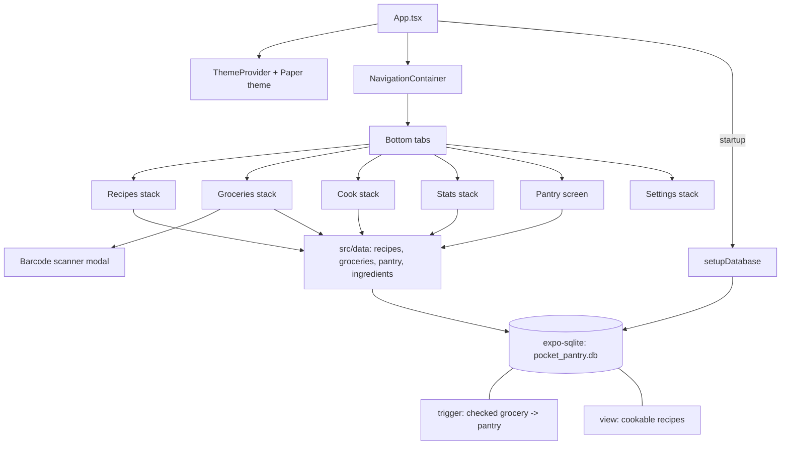

# Pocket Pantry

An offline-first recipe, pantry and grocery planner that tells you what you can cook right now.

<p align="center">
  
</p>

## Why it exists

Most recipe apps assume you will shop for a recipe. Pocket Pantry flips that: you record what is
in your kitchen, and the app shows which recipes you can already make, what is missing for the rest,
and builds a grocery list. Everything is stored in a local SQLite database, so it works on the
train, in the supermarket basement, or anywhere else with no signal, and your data never leaves the device
unless you export it.

## Features

Each item below is implemented in `src/`.

- **Recipes** - create recipes with title, portions, notes and ingredients; view details; swipe to delete (`RecipesScreen`, `AddRecipeScreen`, `RecipeDetailScreen`).
- **Pantry** - list of current stock per ingredient, plus an add-ingredient form (`PantryScreen`, `AddIngredientScreen`).
- **Cook now** - lists recipes whose ingredients are all in stock (SQL view `v_recipes_cookable`); cooking a recipe deducts the used quantities from the pantry (`CookNowScreen`, `cookRecipe`).
- **Grocery list** - add, edit, swipe-delete and check off items; checking an item moves its quantity into the pantry via a database trigger. Includes haptic feedback and a Lottie animation for the empty state (`GroceryScreen`).
- **Stats** - bar chart of pantry stock and a pie chart, via react-native-chart-kit (`StatsScreen`).
- **Barcode scanner** - camera-based scanner opened as a modal from the grocery stack (`BarcodeScannerScreen`, expo-camera).
- **Backup** - export the SQLite database through the share sheet and import one back with the document picker (`SettingsScreen`).
- **i18n** - English and Spanish strings, locale picked from the device (`src/i18n`).
- **Dark theme** - System / light / dark modes using React Native Paper themes (`src/theme`).

## Architecture



Layers: screens (`src/screens`) call plain async functions in `src/data`, which run SQL against the
database opened in `src/db`. Models live in `src/models`, navigation in `src/navigation`.

## Quick start

```bash
git clone https://github.com/haadfida/pocket-pantry.git
cd pocket-pantry
npm install
npx expo start          # Expo dev server
npm run ios             # or: npm run android (native build, needs Xcode / Android Studio)
```

The barcode scanner and SQLite need a native build or a dev client; Expo Go may not cover every module.

## Tech stack

- Expo (SDK 53 per `package.json`) with React Native 0.79 and React 19, TypeScript
- expo-sqlite for storage
- React Navigation 7 (bottom tabs + native stacks)
- React Native Paper, react-native-chart-kit, react-native-swipe-list-view, lottie-react-native
- expo-camera, expo-haptics, expo-localization, expo-sharing, expo-document-picker
- i18n-js, react-hook-form
- ESLint and Prettier

## Roadmap

- [ ] Look up product names from scanned barcodes (the scanner currently only captures codes)
- [ ] Edit existing recipes and ingredients
- [ ] Meal planning calendar
- [ ] Expiry dates and low-stock reminders
- [ ] More languages
- [ ] Automated tests and CI

## License

MIT - see [LICENSE](LICENSE).
